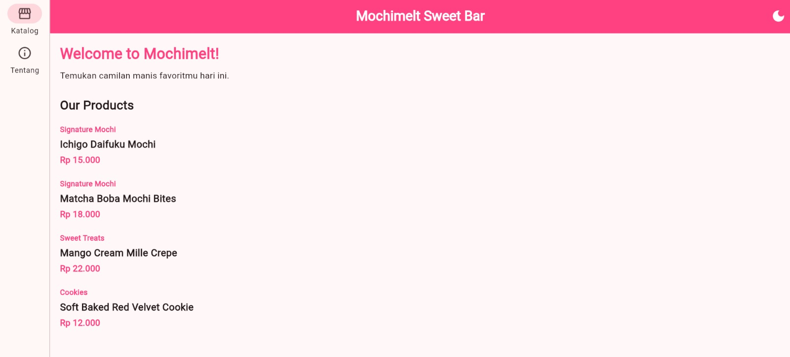
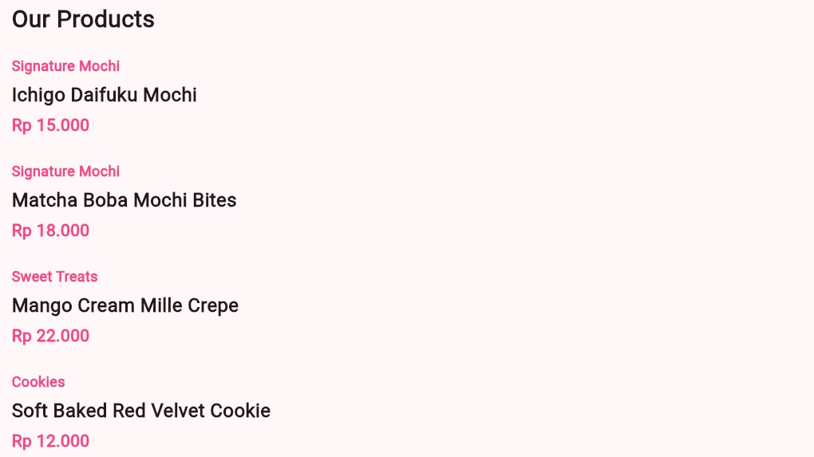
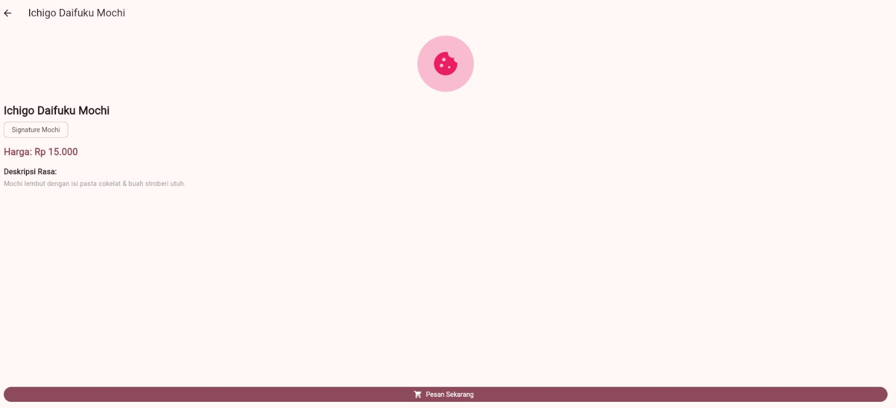
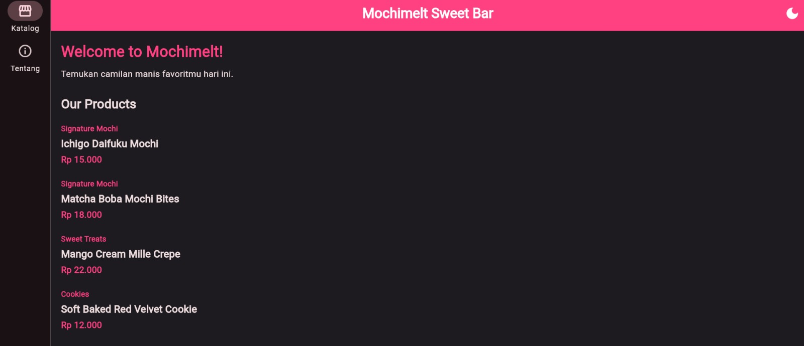
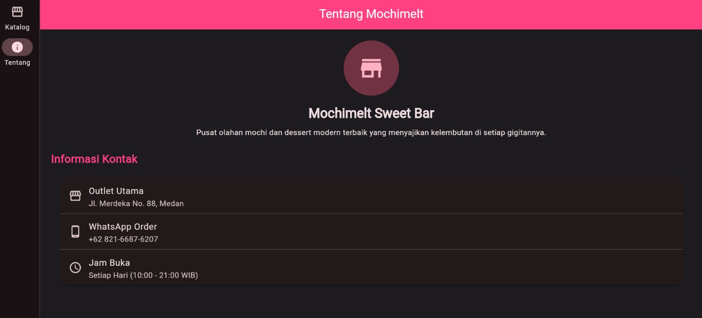

# TUGAS RUTIN 5 – INDIKATOR HALAMAN MENU UMKM MOCHIMELT SWEET BAR

## A. Identitas Mahasiswa

| Keterangan | Identitas |
|---|---|
| Nama | Sevta Simamora |
| NIM | 4243250019 |
| Kelas | PSIK 24C |
| Mata Kuliah | Pemrograman Mobile |
| Tugas | Tugas Rutin 5 |
| Judul Aplikasi | Mochimelt Sweet Bar |

## B. Deskripsi Aplikasi

**Mochimelt Sweet Bar** merupakan aplikasi halaman menu UMKM kuliner berbasis Flutter yang dikembangkan untuk menampilkan informasi toko dan berbagai produk yang ditawarkan. Aplikasi ini dirancang dengan tampilan sederhana dan menarik sehingga pengguna dapat melihat informasi toko, daftar produk, serta detail produk yang tersedia.

Aplikasi ini menggunakan bahasa pemrograman Dart dan framework Flutter dengan penerapan Material Design 3. Selain itu, aplikasi menyediakan fitur perubahan tema terang dan gelap melalui tombol pada halaman utama.

### Fitur Aplikasi

- Menampilkan halaman utama Mochimelt Sweet Bar.
- Menampilkan identitas dan deskripsi toko.
- Menampilkan informasi alamat, nomor WhatsApp, dan jam operasional.
- Menampilkan daftar produk beserta kategori dan harga.
- Menampilkan halaman detail produk.
- Menyediakan fitur favorit pada produk.
- Menyediakan navigasi antara halaman Katalog dan Tentang.
- Menyediakan pilihan tema terang dan gelap.
- Menggunakan Material Design 3.
- Menggunakan GoRouter untuk pengaturan navigasi halaman.

## C. Teknologi yang Digunakan

| Teknologi | Kegunaan |
|---|---|
| Flutter | Framework pengembangan aplikasi |
| Dart | Bahasa pemrograman |
| Material Design 3 | Sistem desain antarmuka |
| GoRouter | Pengelolaan navigasi halaman |
| Google Chrome | Media pengujian aplikasi |
| Visual Studio Code | Editor kode program |

## D. Struktur Folder Proyek

Struktur folder aplikasi Mochimelt Sweet Bar dibuat dengan memisahkan model data, halaman aplikasi, konfigurasi navigasi, dan komponen widget agar kode lebih terorganisasi.

```text
pm_p5_4243250019/
│
├── lib/
│   ├── models/
│   │   └── produk_model.dart
│   │
│   ├── router/
│   │   └── app_router.dart
│   │
│   ├── screens/
│   │   ├── beranda_screen.dart
│   │   ├── detail_produk_screen.dart
│   │   └── tentang_screen.dart
│   │
│   ├── widgets/
│   │   ├── shell_scaffold.dart
│   │   ├── header_toko.dart
│   │   ├── kartu_kontak.dart
│   │   ├── kartu_produk.dart
│   │   └── tombol_favorit.dart
│   │
│   └── main.dart
│
├── test/
│   └── widget_test.dart
│
├── screenshots/
│   ├── halaman-utama.png
│   ├── daftar-produk.png
│   ├── detail-produk.png
│   └── mode-gelap.png
│
├── pubspec.yaml
├── pubspec.lock
└── README.md
```

### Keterangan Struktur Folder

- `models/produk_model.dart`: Menyimpan struktur data produk yang digunakan dalam aplikasi.
- `router/app_router.dart`: Mengatur navigasi dan rute antarhalaman menggunakan GoRouter.
- `screens/beranda_screen.dart`: Mengatur tampilan halaman utama dan daftar produk.
- `screens/detail_produk_screen.dart`: Menampilkan informasi detail produk.
- `screens/tentang_screen.dart`: Menampilkan informasi identitas dan deskripsi toko serta kontak.
- `widgets/shell_scaffold.dart`: Mengatur navigasi utama menggunakan NavigationBar dan NavigationRail.
- `widgets/header_toko.dart`: Menampilkan bagian identitas dan header toko.
- `widgets/kartu_kontak.dart`: Menampilkan informasi alamat, WhatsApp, dan jam operasional toko.
- `widgets/kartu_produk.dart`: Menyediakan komponen tampilan informasi produk.
- `widgets/tombol_favorit.dart`: Menyediakan tombol untuk menandai produk sebagai favorit.
- `main.dart`: Menjadi titik awal aplikasi dan mengatur tema serta konfigurasi utama aplikasi.
- `test/widget_test.dart`: Menyimpan pengujian sederhana untuk aplikasi.

## E. Tangkapan Layar Aplikasi

Tangkapan layar berikut digunakan untuk menunjukkan hasil implementasi dan pengujian aplikasi Mochimelt Sweet Bar.

### 1. Tampilan Halaman Utama



Halaman utama menampilkan nama toko, sambutan kepada pengguna, dan informasi singkat mengenai produk yang ditawarkan.

### 2. Tampilan Daftar Produk



Halaman daftar produk menampilkan nama produk, kategori, dan harga yang tersedia pada Mochimelt Sweet Bar.

### 3. Tampilan Detail Produk



Halaman detail produk menampilkan informasi lebih lengkap mengenai produk yang dipilih pengguna.

### 4. Tampilan Mode Gelap



Tampilan mode gelap menunjukkan perubahan warna latar belakang dan komponen aplikasi ketika pengguna mengaktifkan tema gelap melalui tombol pengaturan tema.

### 5. Tampilan Informasi Toko dan Kontak



Halaman Tentang menampilkan identitas toko, deskripsi singkat, alamat outlet, nomor WhatsApp pemesanan, dan jam operasional.

## F. Diagram Widget Tree

Widget Tree menggambarkan struktur hierarki widget yang digunakan dalam aplikasi Flutter. Pada aplikasi Mochimelt Sweet Bar, struktur dimulai dari MochimeltApp sebagai widget utama yang mengatur konfigurasi tema dan navigasi aplikasi.

```text
MochimeltApp (StatefulWidget)
│
└── MaterialApp.router
    │
    ├── ThemeData (Light Theme)
    ├── ThemeData (Dark Theme)
    │
    └── GoRouter
        │
        └── StatefulShellRoute
            │
            └── ShellScaffold
                │
                ├── NavigationBar
                │   ├── Katalog
                │   └── Tentang
                │
                └── NavigationShell
                    │
                    ├── BerandaScreen
                    │   └── Scaffold
                    │       ├── AppBar
                    │       └── Body
                    │           ├── Welcome
                    │           ├── Our Products
                    │           └── Daftar Produk
                    │
                    └── TentangScreen
                        └── Scaffold
                            ├── AppBar
                            └── Body
                                ├── Identitas Toko
                                ├── Deskripsi Toko
                                └── KartuKontak

DetailProdukScreen
│
└── Scaffold
    │
    └── Detail Informasi Produk
```

### Keterangan Widget Tree

- **MochimeltApp:** Widget utama yang mengatur konfigurasi aplikasi dan perubahan tema.
- **MaterialApp.router:** Mengatur konfigurasi aplikasi dengan sistem navigasi berbasis router.
- **ThemeData:** Mengatur tampilan tema terang dan gelap.
- **GoRouter:** Mengelola rute perpindahan antarhalaman.
- **StatefulShellRoute:** Mengatur navigasi halaman dengan mempertahankan kondisi masing-masing cabang navigasi.
- **ShellScaffold:** Menyediakan navigasi utama aplikasi.
- **BerandaScreen:** Menampilkan halaman utama dan daftar produk.
- **TentangScreen:** Menampilkan informasi identitas dan deskripsi toko.
- **KartuKontak:** Menampilkan alamat, nomor WhatsApp, dan jam operasional.
- **DetailProdukScreen:** Menampilkan informasi lebih lengkap mengenai produk yang dipilih.

`ProdukModel` tidak dimasukkan ke dalam Widget Tree karena merupakan kelas model data, bukan widget Flutter.

## G. Penjelasan Arsitektur Flutter

Flutter memiliki tiga struktur pohon utama yang saling berhubungan dalam proses pembangunan tampilan aplikasi, yaitu Widget Tree, Element Tree, dan RenderObject Tree.

### 1. Widget Tree

Widget Tree merupakan struktur hierarki yang menggambarkan hubungan antarwidget dalam aplikasi Flutter. Setiap widget memiliki fungsi masing-masing untuk membentuk tampilan aplikasi.

Pada aplikasi Mochimelt Sweet Bar, struktur dimulai dari MochimeltApp sebagai widget utama, kemudian MaterialApp.router yang mengatur konfigurasi aplikasi, hingga halaman BerandaScreen dan TentangScreen. Komponen seperti AppBar, NavigationBar, dan KartuKontak digunakan untuk menyusun tampilan aplikasi.

### 2. Element Tree

Element Tree merupakan struktur yang menghubungkan Widget Tree dengan proses pengelolaan tampilan aplikasi. Element berfungsi mengatur hubungan antarwidget serta mempertahankan kondisi widget selama proses pembangunan ulang tampilan.

Pada aplikasi Mochimelt Sweet Bar, Element Tree membantu Flutter mengelola perubahan tampilan ketika pengguna melakukan interaksi, seperti berpindah halaman melalui navigasi atau mengubah tema aplikasi dari terang menjadi gelap.

### 3. RenderObject Tree

RenderObject Tree bertanggung jawab terhadap proses pengaturan tata letak dan penggambaran tampilan ke layar. RenderObject mengatur ukuran, posisi, jarak, serta cara setiap komponen ditampilkan.

Pada aplikasi Mochimelt Sweet Bar, RenderObject membantu mengatur posisi teks produk, informasi toko, tombol navigasi, dan komponen lainnya agar ditampilkan dengan rapi.

### Alasan Pemilihan StatelessWidget dan StatefulWidget

**StatelessWidget**

StatelessWidget digunakan untuk komponen yang tidak membutuhkan perubahan state internal. Pada aplikasi Mochimelt Sweet Bar, BerandaScreen dan TentangScreen menggunakan StatelessWidget karena tampilan keduanya menerima data dan parameter dari bagian lain aplikasi.

Widget seperti KartuKontak juga menggunakan StatelessWidget karena berfungsi menampilkan informasi toko yang tidak berubah selama aplikasi berjalan.

**StatefulWidget**

StatefulWidget digunakan untuk komponen yang membutuhkan pengelolaan state selama aplikasi berjalan. Pada aplikasi Mochimelt Sweet Bar, MochimeltApp menggunakan StatefulWidget untuk mengelola perubahan tema terang dan gelap.

Dengan penggunaan kedua jenis widget tersebut, pengelolaan tampilan dan interaksi aplikasi menjadi lebih terstruktur serta mudah dikembangkan.

## H. Pengujian Aplikasi

Pengujian dilakukan untuk memastikan aplikasi Mochimelt Sweet Bar dapat berjalan dengan baik melalui browser Google Chrome.

### 1. Hasil Pengujian

| No. | Fitur yang Diuji | Hasil yang Diharapkan |
|---|---|---|
| 1 | Halaman utama | Halaman utama dapat ditampilkan |
| 2 | Daftar produk | Nama, kategori, dan harga produk ditampilkan |
| 3 | Detail produk | Informasi produk dapat dibuka |
| 4 | Navigasi Katalog | Pengguna dapat membuka halaman katalog |
| 5 | Navigasi Tentang | Pengguna dapat membuka halaman informasi toko |
| 6 | Informasi kontak | Alamat, WhatsApp, dan jam operasional ditampilkan |
| 7 | Tema terang | Aplikasi menggunakan tampilan terang |
| 8 | Tema gelap | Aplikasi menggunakan tampilan gelap |

Pengujian dilakukan dengan menjalankan aplikasi melalui Google Chrome dan mencoba fitur-fitur yang tersedia. Hasil pengujian digunakan untuk memastikan navigasi, tampilan, dan interaksi aplikasi berjalan sesuai dengan fungsi yang telah diterapkan.

## I. Kesimpulan

Berdasarkan proses pengembangan yang telah dilakukan, aplikasi Mochimelt Sweet Bar berhasil dirancang sebagai aplikasi menu UMKM berbasis Flutter. Aplikasi ini menyediakan halaman utama, daftar produk, detail produk, informasi toko, serta informasi kontak.

Penerapan Material Design 3 memberikan tampilan antarmuka yang sederhana dan konsisten. Selain itu, penggunaan GoRouter membantu mengatur navigasi antarhalaman, sedangkan fitur tema terang dan gelap memberikan pilihan tampilan kepada pengguna.

Dengan adanya pemisahan model, halaman, dan widget, struktur kode aplikasi menjadi lebih terorganisasi dan mudah dikembangkan kembali.

## J. Pernyataan Penggunaan AI

Dalam pengerjaan tugas ini, AI digunakan sebagai alat bantu untuk memahami konsep pengembangan aplikasi Flutter, membantu penyelesaian permasalahan kode, serta membantu penyusunan dokumentasi README.md.

Implementasi kode program, penyesuaian tampilan, dan pengujian aplikasi dilakukan serta diperiksa kembali oleh mahasiswa.

---

**Repository:** `pm_p5_4243250019`

**Nama Aplikasi:** Mochimelt Sweet Bar

**Teknologi:** Flutter, Dart, Material Design 3, GoRouter

**Platform Pengujian:** Google Chrome